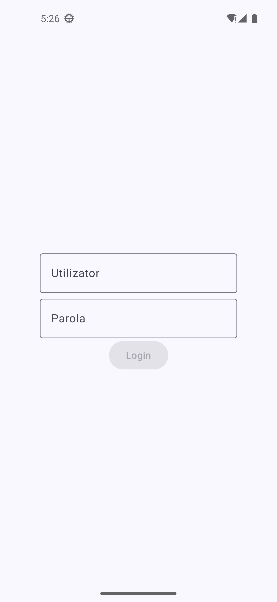
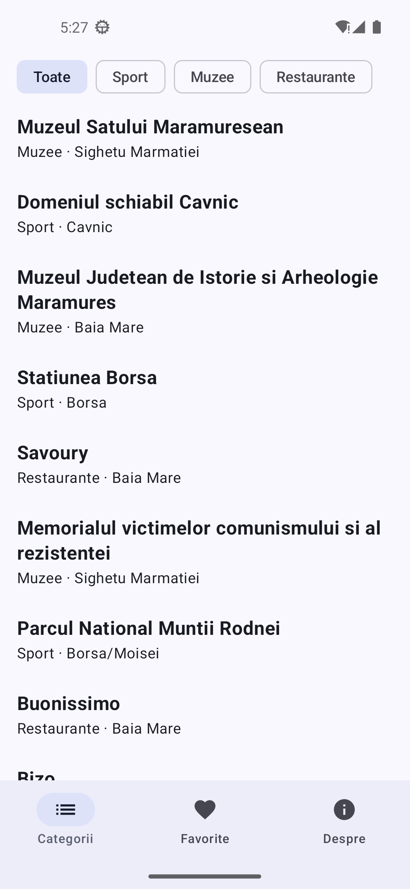
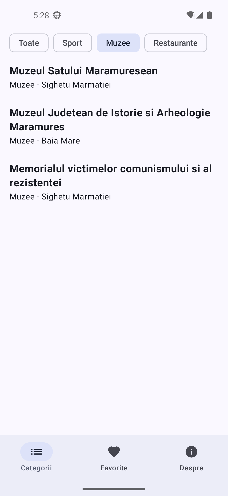
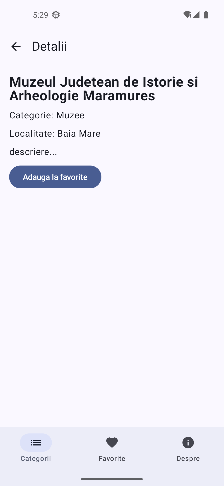
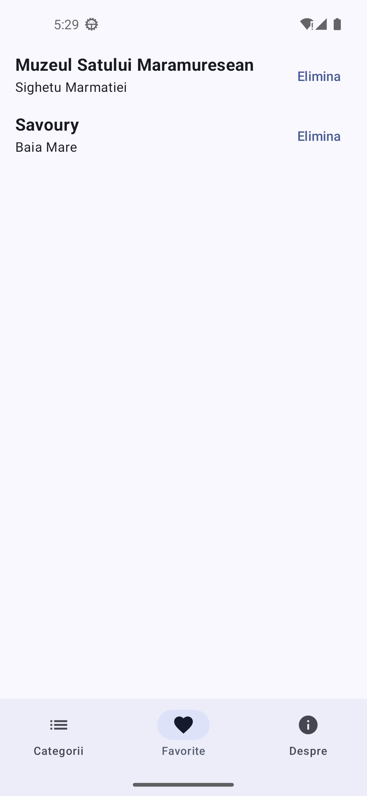
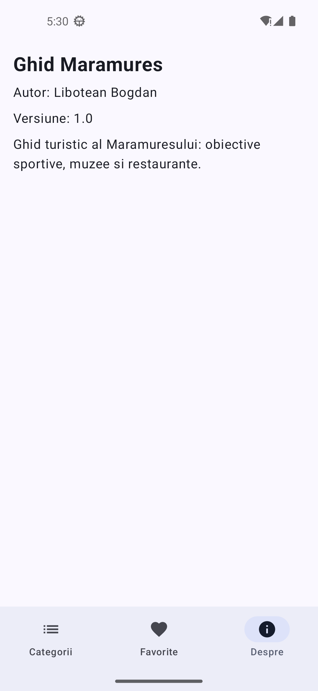

# Ghid Maramures

Aplicatie Android de tip ghid turistic pentru Maramures, realizata pentru laboratorul 05 de Calcul Mobil. 

## Tehnologii

- Kotlin + Jetpack Compose, Material 3
- Navigation Compose (Nav2) cu rute type-safe (`@Serializable`)
- Kotlin Serialization

## Cum se ruleaza

1. Cloneaza repository-ul:
   ```
   git clone https://github.com/Libotean/GhidMaramures
   ```
2. Deschide folderul in Android Studio si asteapta finalizarea **Gradle Sync**.
3. Porneste un emulator sau conecteaza un telefon Android.
4. Apasa **Run**.

La ecranul de autentificare se accepta orice utilizator si parola nevide.

## Structura proiectului

```
app/src/main/java/com/example/ghidmaramures/
├── MainActivity.kt
├── data/
│   ├── Place.kt              # enum Category + data class Place
│   └── PlacesRepository.kt   # sursa unica de date (object)
├── navigation/
│   ├── Routes.kt             # rutele type-safe
│   ├── AppNavHost.kt         # NavHost, starea comuna (favorite), Scaffold
│   └── BottomBar.kt          # bara de navigare inferioara
└── ui/
    ├── LoginScreen.kt
    ├── PlaceListScreen.kt
    ├── PlaceDetailScreen.kt
    ├── FavoritesScreen.kt
    └── AboutScreen.kt
```

### Rute

| Ruta | Tip | Argumente | Ecran |
|---|---|---|---|
| `Login` | `object` | — | Autentificare |
| `CategorieGraph` | `object` | — | Graf imbricat: lista + detaliu |
| `PlaceList` | `object` | — | Lista locurilor cu filtru |
| `PlaceDetail` | `data class` | `id: Int` | Detaliul unui loc |
| `Favorites` | `object` | — | Locurile favorite |
| `About` | `object` | — | Despre aplicatie |

### Tranziții

- **Login -> Categorii.** La apasarea butonului „Login” se navigheaza la `CategorieGraph` cu `popUpTo<Login> { inclusive = true }`. **Aici se curata stiva:** Login este scos, deci Back de pe lista inchide aplicatia in loc sa revina la autentificare.
- **Lista -> Detaliu.** Se transmite doar id-ul locului: `navigate(PlaceDetail(id))`. In destinatie, ruta este refacuta cu `toRoute()`, iar ecranul citeste restul informatiilor din `PlacesRepository`.
- **Detaliu -> Lista.** Sageata din `TopAppBar` si Back-ul sistemului apeleaza aceeasi operatie (`popBackStack()`), deci duc la acelasi ecran. Filtrul listei este pastrat cu `rememberSaveable`.
- **Intre tab-uri.** Navigarea foloseste `popUpTo(graph.id) { saveState = true }`, `restoreState = true` si `launchSingleTop = true`. Fiecare tab isi pastreaza starea (un detaliu deschis in Categorii este tot acolo dupa o vizita in Favorite), iar apasarea repetata pe tab-ul curent nu adauga copii in stiva.

## Capturi de ecran

Capturile se afla in folderul [`screenshots/`](screenshots/).

| Login | Lista (Toate) | Lista (Muzee) |
|---|---|---|
|  |  |  |

| Detaliu | Favorite | Despre |
|---|---|---|
|  |  |  |